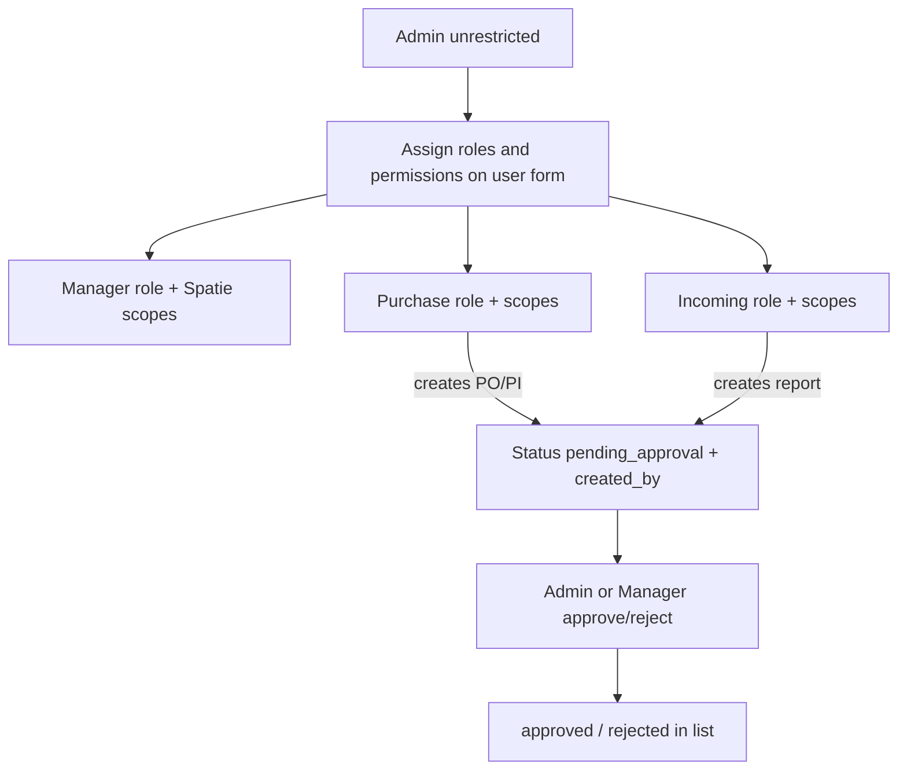

# Roles, permissions, and approval workflow

## Context (today)

- Access is a single `users.user_type` enum (`admin`, `sub_admin`, `staff`, `purchase`, `incoming`, `user`) — not Spatie.
- [`EnsureQualityRole`](app/Http/Middleware/Auth/EnsureQualityRole.php) lets any `isMaster()` user through everything; purchase/incoming are department-scoped.
- Settings/users are gated with `quality.role:master`.
- PO / PI / lots / vendors / categories have **no** `created_by` / approval fields. PI is hardcoded `verified`. Report has unused `verified_by`.
- Incoming users currently land on and fully CRUD vendors/categories.
- Reports have a Livewire show page; PO/PI only have print “format” documents — no in-app view pages.

Spatie `laravel-permission` is already in `composer.json` but unpublished/unused.

---

## Goals

1. Add **Manager** — full app access except Settings/Config; Admin can narrow Manager scopes.
2. Introduce **Roles & Permissions** for everyone except Admin (Admin = unrestricted).
3. CRUD-style permissions: **access / view / add / edit / delete** per module.
4. Department creates (PO, PI, reports, …) store **creator user id**, enter **pending approval**, and Admin/Manager can **approve** → approved status in lists.
5. **Approved vendors** and **list of category** — Admin + Manager only; hide from purchase/incoming.
6. Add missing **view/show pages** for modules like PO and PI (not needed for vendor/category).

---

## Defaults locked for this plan

| Topic | Choice |
|---|---|
| Permission engine | Publish and use **Spatie** (already required) |
| Admin | No permission checks — always allowed |
| Manager default | All quality modules + dashboard + users (optional) + grouping; **no** settings/config |
| Approvals | **PO, PI, Inspection Reports** first |
| Vendor / category | Admin + Manager CRUD; department users **cannot** see routes or nav |
| Incoming home after vendor hide | `admin::quality.incoming.parts` (or reports — confirm) |
| Legacy `sub_admin` / `staff` | Treat like Manager for access (or map to Manager role on migrate); stop offering them as new assignable types |
| Pending edits | Creator may edit while `pending`; after `approved`, only Admin/Manager may edit (or lock entirely) |

---

## Architecture

### Roles

| Role | Meaning |
|---|---|
| `admin` | Superuser. Settings + config. Cannot be permission-restricted. |
| `manager` | Operational owner. Approves records. Default: all quality + non-settings screens. Admin can change scopes. |
| `purchase` | Department user. Creates PO/PI (pending). No vendors/categories. No settings. |
| `incoming` | Department user. Creates reports (pending). No vendors/categories. No settings. |

Keep `user_type` as the primary role label for login/home/nav simplicity, and sync a matching Spatie role. Permissions attach to the user (and/or role defaults that Admin can override per user).

### Permission catalog (module × action)

Modules (examples):

- `quality.analysis`, `quality.alerts`
- `quality.purchase.orders`, `quality.purchase.invoices`
- `quality.incoming.parts`, `quality.incoming.standards`, `quality.incoming.sampling`, `quality.incoming.reports`
- `quality.incoming.vendors`, `quality.incoming.categories` (Admin/Manager only by default)
- `users` (if Manager may manage users — default **yes view/edit**, Admin-only for promoting to Admin)
- `settings.*` — **Admin only**, never grantable to Manager

Actions per module: `access` (nav + route), `view`, `add`, `edit`, `delete`.

Naming: `quality.purchase.orders.view`, `quality.purchase.orders.add`, …

Default seeds:

- **Manager**: all quality `*` except nothing under `settings`; includes vendor/category and approve capability.
- **Purchase**: orders + invoices access/view/add/edit (delete optional); analysis/alerts view; **no** vendors/categories.
- **Incoming**: parts/standards/sampling/reports access/view/add; report edit/delete per current rules or permission; **no** vendors/categories.

### Approval capability

Separate permission: `quality.approvals.manage` (or per-module `….approve`).

Only Admin and Manager (with that permission) see Approve / Reject actions.

---

## Data model changes

### Users / Spatie

1. Publish Spatie migrations + `config/permission.php`.
2. Add `manager` to `users.user_type` enum.
3. Seed roles + permissions; backfill existing users to Spatie roles from `user_type`.
4. `User`: `HasRoles`; helpers `isManager()`, `isAdminUser()` (true admin only), replace overloaded `isMaster()` usage carefully:
   - Settings routes → `user_type === 'admin'` (or permission `settings.manage`).
   - Quality broad access → Admin **or** permission checks (Manager included via permissions).

### Creatable records — creator + approval columns

Add to `purchase_orders`, `purchase_invoices`, `inspection_reports` (and later lots if needed):

| Column | Type | Notes |
|---|---|---|
| `created_by` | FK `users`, nullable for legacy | Set on create from `auth()->id()` |
| `approval_status` | enum/string | `pending`, `approved`, `rejected` |
| `approved_by` | FK `users`, nullable | Admin/Manager who acted |
| `approved_at` | timestamp, nullable | |
| `rejection_reason` | text, nullable | optional |

Keep existing operational statuses (`open`/`partial`/… for PO; report `result`) separate from **approval_status**.

Migration for existing rows: set `approval_status = approved`, `created_by = null` so current data stays usable.

### Workflow rules

1. Purchase/Incoming **create** → `approval_status = pending`, `created_by = auth id`.
2. Lists show approval badge + Created by.
3. Admin/Manager can Approve or Reject (with optional reason).
4. Downstream effects (configurable, default):
   - Pending PO: cannot book invoice until approved (or allow draft PI — prefer **block until approved**).
   - Pending PI: lots still created but flagged pending, or delay lot creation until PI approved — prefer **create lots but mark pending** OR block inspection until PI approved.
   - Pending report: lot result update waits until report approved — prefer **apply lot result only on approve**.
5. Admin/Manager creates: auto-`approved` (or still pending — prefer **auto-approved**).

---

## UI / routes

### User form ([users-add-edit-page](Modules/Core/resources/views/livewire/admin/users/users-add-edit-page.blade.php))

- Assignable types: `admin`, `manager`, `purchase`, `incoming`.
- For non-admin: **Roles & Permissions** panel — module matrix with access/view/add/edit/delete checkboxes.
- Manager: matrix pre-checked to full quality scopes; Admin can uncheck.
- Hide settings permissions from UI entirely (Admin-only by code).
- Show “Approval by: Admin or Manager” helper text where relevant.

### Navigation ([Navigation.php](Modules/Core/app/View/Components/Layouts/App/Navigation.php))

- Drive visibility from permissions (with Admin bypass).
- Remove vendors/categories from purchase/incoming nav.
- Manager sees both Purchase and Incoming groups (if scoped).
- Settings group: Admin only.

### Middleware

Replace / extend `EnsureQualityRole`:

- Admin → allow.
- Else require matching Spatie permission for the route group (e.g. `quality.purchase.orders.access`).
- Keep thin role shortcuts for department home routes.

### Vendor / category

- Routes: `quality.role` / permission restricted to Admin + Manager (`quality.incoming.vendors.*`, `categories.*`).
- Update [`User::adminHomeRoute()`](app/Models/User.php): incoming → parts (or reports), not vendors.
- Tests: incoming/purchase **403** on vendors/categories; manager **200**.

### Approval actions on list + show

- PO list / show: Approve, Reject; columns Created by, Approval.
- PI list / show: same.
- Reports list / show: same (wire into unused `verified_by` or use `approved_by` consistently — prefer new `approved_by` for all three).

### Missing view pages

Add Livewire show pages (read-only + approval actions + link to edit/format):

| Module | New route | Notes |
|---|---|---|
| PO | `purchase.orders.show` | Lines, vendor, status, approval, format/edit links |
| PI | `purchase.invoices.show` | Lines, lots, linked PO, approval |
| (Optional later) Parts / sampling | show if useful | Not required in first pass |
| Vendor / category | **skip** | Modal CRUD enough |

List rows get a **View** action (keep Format / Edit as today, gated by permission).

---

## Implementation phases

### Phase 1 — Roles & permissions foundation

1. Publish Spatie; migrations; seed roles/permissions.
2. Add `manager` user_type; User helpers; assignable roles.
3. Permission middleware / Gate helpers (`canModuleAction`).
4. User form permission matrix (Admin editing non-admin users).
5. Navigation + route gates; settings Admin-only.
6. Feature tests for Admin / Manager / Purchase / Incoming access matrix.

### Phase 2 — Hide vendor/category from departments

1. Route + nav + home route changes.
2. Update QualityAccessTest / QualityPagesTest.

### Phase 3 — Creator + approval on PO / PI / reports

1. Migrations for approval columns.
2. `QualityWorkflow` sets `created_by` + pending/auto-approved.
3. Approve/Reject actions (service methods + UI).
4. List filters/badges; block dependent actions while pending.
5. Tests for create → pending → approve flow.

### Phase 4 — Show pages for PO / PI

1. `order-show-page`, `invoice-show-page` Volt components.
2. Routes + list View links + permission `view`.
3. Mirror useful fields from format documents in-app.

---

## Key files to touch

- [`app/Models/User.php`](app/Models/User.php)
- [`app/Http/Middleware/Auth/EnsureQualityRole.php`](app/Http/Middleware/Auth/EnsureQualityRole.php) (or new permission middleware)
- [`Modules/Core/app/View/Components/Layouts/App/Navigation.php`](Modules/Core/app/View/Components/Layouts/App/Navigation.php)
- [`Modules/Core/resources/views/livewire/admin/users/users-add-edit-page.blade.php`](Modules/Core/resources/views/livewire/admin/users/users-add-edit-page.blade.php)
- [`Modules/Core/routes/web.php`](Modules/Core/routes/web.php) — settings Admin-only
- [`Modules/Quality/routes/web.php`](Modules/Quality/routes/web.php)
- [`Modules/Quality/app/Services/QualityWorkflow.php`](Modules/Quality/app/Services/QualityWorkflow.php)
- PO/PI/report models + new migrations
- New: permission seeder, approval service, order/invoice show pages
- Tests under `tests/Feature/Quality/` and users access

---

## Out of scope (first delivery)

- Full Spatie UI package / external admin theme
- Approving vendors via workflow (they stay Admin/Manager direct CRUD)
- Standalone Incoming Lot list/show
- Email/WhatsApp “pending approval” digests (can follow later)
- Reworking `sub_admin`/`staff` beyond mapping them to Manager-like access

---

## Open confirmations (before coding)

1. Incoming landing page after removing vendors: **Parts** or **Reports**?
2. Should Manager be allowed to **create/edit users**, or only Admin?
3. Confirm approval entities: **PO + PI + Reports** only for v1?
